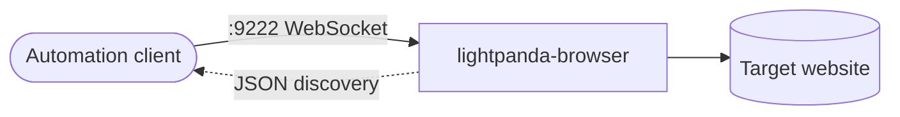

# Lightpanda

Lightpanda is an open-source headless browser written in Zig, built for AI agents and automation.
It is not a Chromium fork: it has no graphical rendering engine, runs ~16x lighter and ~9x faster than headless Chrome,
and exposes a Chrome DevTools Protocol (CDP) server that works with Puppeteer, Playwright and chromedp.

## How Lightpanda works



1. The container runs `lightpanda serve`, a CDP server listening on port `9222`.
2. Clients connect over WebSocket (`ws://127.0.0.1:9222`) using `puppeteer.connect` / `chromium.connectOverCDP`.
3. `GET /json/version` returns discovery JSON (browser version + `webSocketDebuggerUrl`).
4. `GET /` only accepts WebSocket upgrade requests — a plain HTTP request returns `400 Missing required header` (expected, not an error).

## Stack details in this repo

- Image: `lightpanda/browser:latest`
- Container name: `lightpanda-browser`
- Ports: `9222:9222` (bound to `127.0.0.1` — CDP has no authentication)
- Persistent data: none (browser is stateless per run)

## Environment variables

Set via `.env` (copy from `.env.example`):

- `LIGHTPANDA_PORT` (default: `9222`) — host port for the CDP server
- `LIGHTPANDA_DISABLE_TELEMETRY` (default: `true`) — disables usage telemetry

## How to run

From the repository root:

```bash
cd lightpanda
cp .env.example .env
docker compose up -d
```

Test:

```bash
# Health / discovery endpoint (expected: HTTP 200 + JSON)
curl http://localhost:9222/json/version

# Root path requires a WebSocket upgrade — "Missing required header" here is expected
curl http://localhost:9222
```

Connect a CDP client (example with Puppeteer):

```js
import puppeteer from 'puppeteer-core';

const browser = await puppeteer.connect({
  browserWSEndpoint: 'ws://127.0.0.1:9222',
});
const page = await browser.newPage();
await page.goto('https://example.com');
console.log(await page.title());
await browser.disconnect();
```

Useful commands:

```bash
docker compose ps
docker compose logs -f
docker compose restart
docker compose down
```

## Usage guide

### Use case 1 — One-shot page dump (scraping / archiving)

No CDP client needed; run `lightpanda fetch` and exit:

```bash
# HTML
docker run --rm lightpanda/browser:latest lightpanda fetch --dump html https://example.com

# Markdown (great for feeding LLMs)
docker run --rm lightpanda/browser:latest lightpanda fetch --dump markdown https://example.com

# PDF / structured metadata
docker run --rm lightpanda/browser:latest lightpanda fetch --dump pdf https://example.com > page.pdf
docker run --rm lightpanda/browser:latest lightpanda fetch --dump structured_data https://example.com

# Wait for JS to finish before dumping
docker run --rm lightpanda/browser:latest lightpanda fetch \
  --wait-until networkidle0 --wait-selector "article" \
  --dump html https://example.com
```

Useful flags: `--obey-robots` (respect robots.txt), `--log-level info`, `--wait-ms 2000`.

### Use case 2 — CDP automation with Puppeteer

Keep the compose stack running, then connect (do **not** launch a browser):

```js
// npm install puppeteer-core
import puppeteer from 'puppeteer-core';

const browser = await puppeteer.connect({
  browserWSEndpoint: 'ws://127.0.0.1:9222',
});
const page = await browser.newPage();
await page.goto('https://example.com', { waitUntil: 'networkidle0' });

// Extract data
const data = await page.evaluate(() => ({
  title: document.title,
  links: [...document.querySelectorAll('a')].map(a => a.href),
}));
console.log(data);

// Fill and submit a form
await page.type('#search', 'docker compose');
await Promise.all([page.click('#submit'), page.waitForNavigation()]);

await browser.disconnect(); // never browser.close() — it kills the shared server
```

### Use case 3 — CDP automation with Playwright

```js
// npm install playwright-core
import { chromium } from 'playwright-core';

const browser = await chromium.connectOverCDP('ws://127.0.0.1:9222');
const context = browser.contexts()[0] ?? await browser.newContext();
const page = await context.newPage();
await page.goto('https://example.com');
console.log(await page.title());
await browser.close(); // disconnects only, server keeps running
```

### Use case 4 — AI agent / MCP

Expose Lightpanda as an MCP server so an agent can browse the web:

```bash
# stdio transport (for Claude Code, Cursor, etc.)
docker exec -i lightpanda-browser lightpanda mcp
```

MCP client config:

```json
{
  "mcpServers": {
    "lightpanda": {
      "command": "docker",
      "args": ["exec", "-i", "lightpanda-browser", "lightpanda", "mcp"]
    }
  }
}
```

Or HTTP transport with independent sessions per client:

```bash
docker run -d --name lightpanda-mcp -p 127.0.0.1:9223:9223 \
  lightpanda/browser:latest lightpanda mcp --host 0.0.0.0 --port 9223
```

### Use case 5 — Health check / CI probe

```bash
curl -fsS http://localhost:9222/json/version && echo "OK"
```

Add as a CI step or monitoring probe; exit code is non-zero on failure (`-f`).

### Use case 6 — Batch crawl from a script

```bash
#!/usr/bin/env bash
for url in https://example.com https://example.org; do
  name=$(echo "$url" | sed 's|https://||;s|/|_|g')
  docker run --rm lightpanda/browser:latest \
    lightpanda fetch --dump markdown "$url" > "${name}.md"
done
```

## Use it effectively

- Use `curl http://localhost:9222/json/version` as the health check, not `curl http://localhost:9222`.
- The image has no shell tools (no curl/wget), so healthchecks must run from the host.
- One-shot fetch without a server: `docker run --rm lightpanda/browser:latest lightpanda fetch --dump html https://example.com`
- Keep the port bound to `127.0.0.1`; exposing CDP on `0.0.0.0` gives unauthenticated full browser control to the network.
- The CDP server is shared: one container serves one connection at a time in simple setups — do not call `browser.close()` from clients, use `disconnect()`.

## Notes

- `Missing required header` on `GET /` is normal: Lightpanda's root path only serves the WebSocket CDP handshake.
- Lightpanda does not render screenshots (no graphical engine); use `--dump html/markdown/pdf` instead.
- No volumes are defined — cookies and page state do not survive container recreation.

## References

- Official site: <https://lightpanda.io>
- Documentation: <https://lightpanda.io/docs>
- GitHub repository: <https://github.com/lightpanda-io/browser>
- Docker Compose guide: <https://docs.docker.com/compose/>
- Docker Hub image: <https://hub.docker.com/r/lightpanda/browser>
