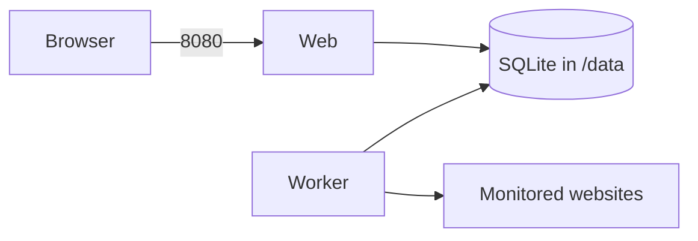

# SiteWatcher

SiteWatcher monitors website uptime and response times and warns before TLS
certificates or domain registrations expire.

## How SiteWatcher works



The web service displays results. The worker runs scheduled checks. Both use
the same image and share the SQLite database in a named volume.

## Stack details in this repo

- Image: official `ghcr.io/nikkurkov/sitewatcher`, pinned by digest in Compose
- Services: `web`, `worker`, and the one-time `setup` command
- Port: `127.0.0.1:8080` by default
- Persistent data: `sitewatcher-data:/data`

## Environment variables

`SITEWATCHER_PORT` changes the host port. It defaults to `8080`.

## How to run

```sh
cd sitewatcher
cp .env.example .env
docker compose run --rm setup
docker compose up -d
curl -fsS http://127.0.0.1:8080/healthz
```

Choose a username and password at the setup prompt. Sign in at
http://127.0.0.1:8080/ and add the websites you want to check.

## Use it effectively

Use `docker compose ps` to check the services and
`docker compose logs -f worker` to follow the worker's logs.

## Notes

Keep the named volume when updating or stopping the stack. The web port only
listens on loopback. For remote access, use the upstream reverse-proxy setup.

## References

- [Source and setup](https://github.com/NikKurkov/sitewatcher)
- [User guide](https://github.com/NikKurkov/sitewatcher/blob/main/docs/usage.en.md)
- [Container image](https://github.com/users/NikKurkov/packages/container/package/sitewatcher)
